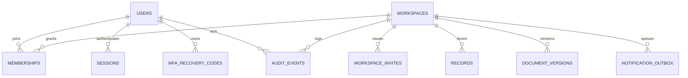

# مدل دادهٔ اجراشده در Private Preview

این نمودار ارتباط جدول‌های SQLite را نشان می‌دهد. ارجاع‌های داخل JSON با `parseState` کنترل می‌شوند. رابطهٔ `RECORDS.project_id` با پروژه و ارجاع `notification_outbox.reminder_id` کلید خارجی SQL ندارند.

- کلید رکورد `(workspace_id, kind, id)` است. پروژه، تسک، منابع، حسابداری، یادآوری، ارجاع Vault و تنظیمات در payload همین جدول نگهداری می‌شوند.
- نسخهٔ سراسری Workspace نوشتن قدیمی را رد می‌کند. Editor برای تغییر یک رکورد به همان نسخه وابسته است.
- `document_versions` با `(workspace_id, document_id, revision)` تاریخچهٔ سند را جدا نگه می‌دارد.
- `notification_outbox` وضعیت تحویل را برای کانال و موعد نگه می‌دارد. Worker تلگرام اطلاعات retry را جداگانه ثبت می‌کند.
- PostgreSQL در Runtime فعال نیست. [پیش‌نویس مدل مقصد](POSTGRES-TARGET-DRAFT.sql).
