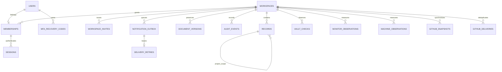

# ProjectOS implemented data model

`records(workspace_id, kind, id)` holds one project, task, resource, document, Vault reference, reminder, incident, expense, charge, contract, revenue entry, invoice or payment per row. Workspace preferences use the `preferences/singleton` row. The document history survives deletion. The write service prevents reusing old project and document IDs where earlier deletion was recorded. Membership grants are stored as a bounded list of project IDs with null denoting the entire Workspace. Applications must enforce both role and project scope before exposing a payload or a field.

An invoice belongs to one project and may contain up to 24 dated installments. Each posted payment points to an invoice in the same project and currency. The record service enforces payment totals and workspace-wide uniqueness of normalized invoice and payment references under the transaction's workspace lock. Issued invoices retain their original terms. Only invoices with zero recorded payments can be voided. Migration 005 adds the new record kinds to the PostgreSQL constraint while preserving existing rows.

`record_version` is the revision at the last write. `record_tombstones` retains delete revisions. Combined with the workspace watermark it supports optimistic conflicts without losing independent edits. `sqlite_imports` records a source digest, table counts and import time. Authentication rate limits and worker heartbeats have dedicated tables.

The SQL migrations show physical SQL constraints. Arrows above include logical relationships enforced by the repository, such as the link between delivery and retry lease. Secrets stored for authentication are encrypted TOTP provisioning state and one-way hashes. Vault record payloads contain locators and approved link metadata. [Runtime ADR](ADR-002-postgres-runtime.md)
